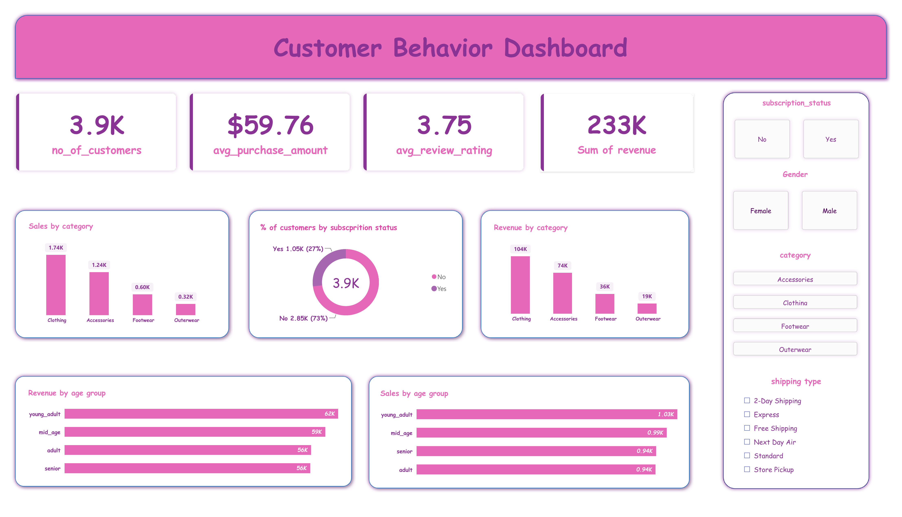

# 🛍️ Customer Behavior Analytics (Python · MySQL · Power BI)

An end-to-end data analytics project: raw CSV → cleaning in **Python** → analysis in **MySQL** → interactive **Power BI** dashboard.

## 📌 Project Overview
The project studies the shopping behaviour of **3,900 customers** to answer questions like:
- Which categories and age groups bring in the most revenue?
- Do subscribers spend more than non-subscribers?
- Are repeat buyers more likely to subscribe?
- How loyal are the customers?

## 📊 Key Results
| KPI | Value |
|---|---|
| Total Revenue | $233,081 |
| Customers | 3,900 |
| Average Purchase | $59.76 |
| Average Review Rating | 3.75 / 5 |
| Subscribers | 27% (1,053 customers) |

## 🔍 Insights
- Clothing + Accessories bring in **77%** of revenue
- Male customers contribute **68%** of revenue because there are more of them (2,652 vs 1,248). Average spend is almost the same (Male $59.54, Female $60.25)
- Subscribers do **not** spend more: $59.49 vs $59.87 per purchase
- Repeat buyers (more than 5 previous purchases) are not more likely to subscribe: 27.6% vs 27.0% overall
- **80%** of customers are "loyal" (11–50 previous purchases)
- Ages 18–31 bring in the most revenue (27%), but all four age groups are close (24–27%)

## ⚙️ Workflow
| Step | Tool | What was done |
|---|---|---|
| 1 | Python (pandas) | Cleaned column names, filled missing review ratings with the category median, created age groups, converted purchase frequency to days, dropped the duplicate `promo_code_used` column |
| 2 | SQLAlchemy | Loaded the clean data into a MySQL table |
| 3 | MySQL | Answered 10 business questions |
| 4 | Power BI | Built the dashboard with KPI cards, charts and filters |

## 🗄️ SQL Questions Answered
1. Total revenue: male vs female
2. Customers who used a discount but still spent above average
3. Top 5 products by average review rating
4. Average purchase: Standard vs Express shipping
5. Do subscribers spend more?
6. Top 5 products by discount rate
7. Customer segments: new, returning, loyal
8. Top 3 products in each category
9. Are repeat buyers more likely to subscribe?
10. Revenue by age group

Techniques used: `GROUP BY`, subqueries, `CASE`, `DENSE_RANK()`, `ROW_NUMBER()`.

## 📈 Power BI Dashboard
- **KPI cards:** customers, average purchase, average rating, revenue
- **Charts:** sales and revenue by category, sales and revenue by age group, % of customers by subscription status
- **Filters:** subscription status, gender, category, shipping type

`dashboard_redesigned.png` is a redesigned summary picture of the same numbers.

## 🗂️ Files
| File | What it is |
|---|---|
| `customer_behavior_cleaning.py` | Python cleaning and loading script |
| `customer_behavior_queries.sql` | The 10 MySQL queries |
| `customer_behavior_dashboard.pbix` | Power BI dashboard (open in Power BI Desktop) |
| `dashboard.png` | Dashboard image |
| `dashboard_redesigned.png` | Redesigned summary image |

## ▶️ How to Run
1. Install: `pip install pandas sqlalchemy pymysql`
2. Put `customer_shopping_behavior.csv` in the same folder as the script
3. In `customer_behavior_cleaning.py`, replace `YOUR_PASSWORD` with your MySQL password
4. Run the script, then run the queries in `customer_behavior_queries.sql`
5. Open the `.pbix` file in Power BI Desktop

## 👤 Author
**R. Gnana Jegath Ratchagan**
MBA (Logistics & Finance) | Aspiring Data Analyst
🔗 [LinkedIn](https://www.linkedin.com/in/ratchagan99)
